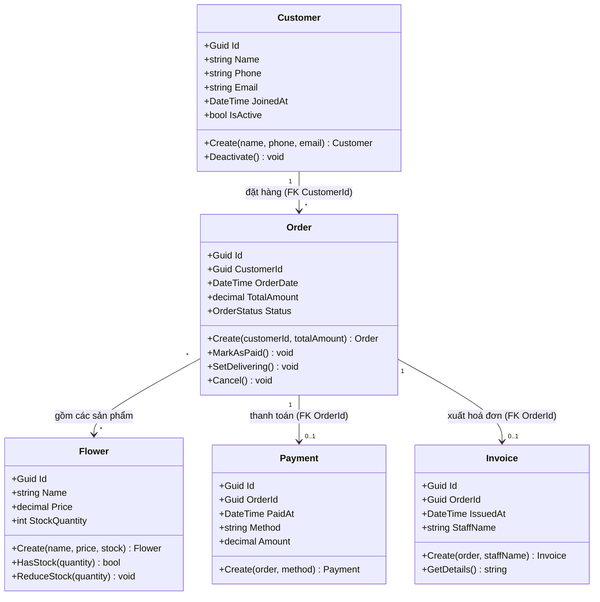

    User Story – Khách hàng
    US-01 Khách hàng: tạo đơn hàng (đặt hoa)
        •	1. Giỏ hàng có sản phẩm -> đặt hàng -> tạo Order (Pending = chờ thanh toán)
        •	2. Giỏ hàng trống -> đặt hàng -> báo lỗi
    US-02 Khách hàng: thanh toán bằng mã QR
        •	1. Đơn hàng Pending -> thanh toán -> sinh mã QR, trạng thái chuyển thành Paid (đã thanh toán)
        •	2. Đơn hàng Cancelled -> thanh toán -> bị từ chối

    User Story – Nhân viên 
    US-03 Nhân viên: xuất hóa đơn bán hàng
        •	1. Đơn hàng Paid -> in hóa đơn -> tạo file text invoice chứa chi tiết Order
        •	2. Đơn hàng Pending -> in hóa đơn -> bị từ chối (do chưa thanh toán)
    US-04 Nhân viên: xác nhận giao hàng
        •	1. Đơn hàng Paid -> giao hàng -> đổi trạng thái thành Delivering (đang giao)
        •	2. Đơn hàng Pending / Cancelled -> giao hàng -> báo lỗi
    User Story – Chủ cửa hàng 
    
    US-05 Chủ cửa hàng: xem báo cáo doanh thu
        •	1. Chọn tháng có đơn hàng Paid -> xem báo cáo -> thấy tổng doanh thu và số lượng đơn
        •	2. Liệt kê từng đơn: hiển thị chi tiết các đơn hàng đã thanh toán thành công

